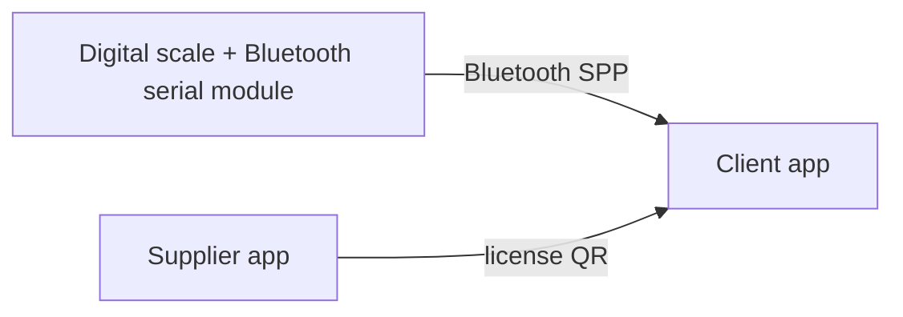
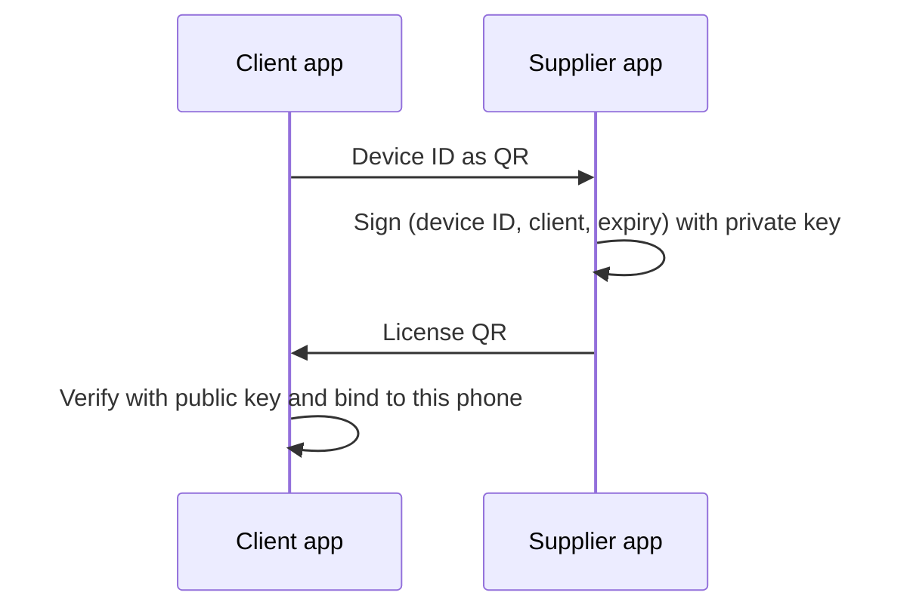

# WeighSync

**A Bluetooth companion app for digital weighing scales, first built for dairy collection centres, with offline, PC-free licensing that a scale distributor can run entirely from a phone.**

  

<p align="center">
  
  
  
</p>

---

## The problem

Businesses that weigh goods all day on digital scales, such as dairy collection counters, need more than a small display. A scale distributor who wants to give those customers a mobile app runs into four practical problems:

1. **Reading the scale on a phone is not enough.** Customers need a large, steady number, a clear stable/unstable signal, and quick **TARE** and **KG ↔ LITRE** controls.
2. **The distributor must stay in control.** Only registered phones should work, activation must be done by the supplier, and the app must stop working until it is **renewed every year**.
3. **The usual tooling does not fit the field.** Suppliers often have no PC, patchy internet, and the app is shared directly instead of through the Play Store.
4. **The users are not technical.** Typing codes, pairing steps and English-only screens are barriers for many customers.

## Who suffers

| Who | Pain today |
|---|---|
| **Dairy operators and farmers at the counter** | Hard-to-read scale display, no easy unit switch, English-only or technical apps |
| **Scale suppliers and distributors** | No simple way to license, renew or track the apps they give customers; no PC; weak control over copies of the APK |
| **The scale business behind them** | App sharing between phones, unpaid renewals, support calls for activation |

## Our solution

WeighSync is **two small Android apps** that work together:

- **Client app (Smart Scale)** reads the scale over Bluetooth and shows a large, steady weight.
- **Supplier app (Scale Supplier)** lets the distributor register clients, issue and renew licenses, and track expiry, **from a phone, with no server and no PC.**

### What makes it different

- **Offline signed licenses.** The supplier app signs `device ID + client + expiry date` with an RSA private key. The client app verifies it with the public key only. No server is needed, so it works in villages with no network.
- **Scan-only activation.** The client shows a QR with its Device ID, the supplier scans it, issues the license, and the client scans the license QR. Nobody types a code.
- **Device-bound and yearly.** A license works on one phone only, and expires on a date. Renewal adds days on top of the remaining time and needs no scan.
- **Built for the counter.** Tamil / English toggle, spoken weight in Tamil or English, a beep and vibration when the weight settles, screen kept on while weighing.
- **Dairy-specific litre handling.** KG ↔ LITRE with a configurable rounding rule, so counters get the same whole-number style values their scale shows.
- **Expiry that does not surprise anyone.** In-app banner, a daily pop-up and a background notification before the license ends, with a one-tap call to the supplier.
- **Distribution without the Play Store.** Signed APK, shared by link from inside the supplier app.

## How it works





## Features

**Client app**
- Live weight from the scale, updated only when the value changes
- Stable-weight detection, beep, vibration and voice
- TARE and UNIT (KG / LITRE) controls
- Tamil / English interface
- Scan-only activation, expiry alerts, clock-rollback protection
- DIAG panel (debug builds) with a raw data log and command tests

**Supplier app**
- PIN-protected, private key encrypted with the Android Keystore
- Client list with expiry colours (green, amber, red)
- Add client by scanning the client's QR, issue and renew licenses
- Choose the renewal period: 3 months, 6 months, 1 year, 2 years or custom
- Duplicate protection (same phone or number cannot be added twice)
- "Send app to client" message in Tamil and English

## Tech stack

Kotlin, Jetpack Compose (Material 3), Classic Bluetooth serial (SPP), ZXing for QR, Android Keystore, RSA (SHA256withRSA), WorkManager, Android TextToSpeech. Python script for test licenses.

## Repository layout

```
weighsync/
├── client-app/          # Smart Scale (dairy side)
├── supplier-app/        # Scale Supplier (distributor side)
├── tools/gen_license.py # dev tool: make a key pair and test licenses
├── docs/                # screenshots, notes
└── README.md
```

## Getting started

1. Open `client-app` and `supplier-app` in Android Studio (minimum SDK 26).
2. Make a key pair (needs `pip install cryptography`):
   ```bash
   python tools/gen_license.py keygen        # prints the PUBLIC key, writes private.pem
   ```
3. Paste the **public** key into `License.PUBLIC_KEY_B64` in the client app. Set `SUPPORT_PHONE` in `Strings.kt`.
4. Build both apps. In the supplier app, create a PIN and import `private.pem` once.
5. Pair the scale in the phone's Bluetooth settings, open the client app, and pick it.
6. Activate: the client shows its QR, the supplier adds the client and shows the license QR, and the client scans it.

## Security notes

- `private.pem` is the **master key**. Never commit it, never ship it inside the client app. Keep an offline backup.
- Keystores (`*.jks`), `local.properties` and real client lists must stay out of the repository (see `.gitignore`).
- Offline licenses protect a casual copy of the app, not a determined attacker who edits the APK. Treat this as licensing, not DRM.

## Status

| Area | State |
|---|---|
| Read weight over Bluetooth, stable detection | Working |
| Offline signed licenses, QR activation, renewals | Working |
| Tamil / English, voice, expiry alerts | Working |
| KG ↔ LITRE on the phone (configurable rounding) | Working |
| Phone → scale commands (remote TARE / unit key) | **In progress**: the scale accepts commands from another app, and the exact command bytes are being validated in this one. The app falls back to phone-side conversion and tare. |
| Remote block of a client (Firebase) | Planned |

## Roadmap

- Remote block / unblock of a client's license
- Auto-capture of readings, farmer-wise records and daily reports
- Shorter license signature (ECDSA) for easier QR scanning
- Bluetooth printer receipts

## Tested with

An ANNAI digital weighing scale with a Bluetooth serial module (device name `BT3625`) on Android phones running Android 8 and above. WeighSync is designed for digital scales that stream their weight over Bluetooth serial; other models have not been tested yet.

## License

Choose a license before publishing (for example MIT for open source, or "All rights reserved" if this is your commercial product).
